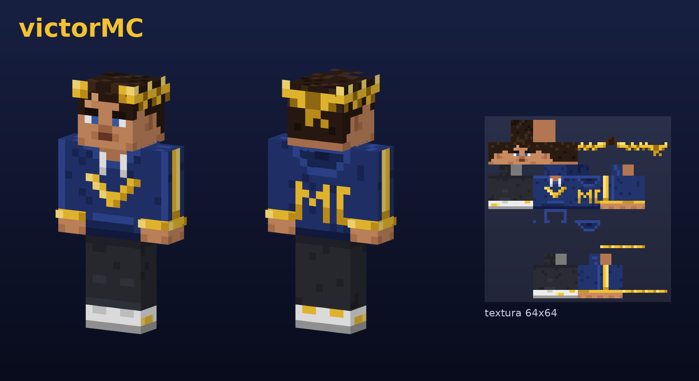

# Skin victorMC



**Concepto:** *Victor* = vencedor. Corona de laurel dorada, sudadera azul marino
con una **V** dorada en el pecho y **MC** en la espalda, franjas y puños dorados,
vaqueros oscuros y zapatillas blancas.

- Archivo: [`victorMC.png`](victorMC.png) — 64×64, modelo **Clásico** (brazos anchos, tipo Steve).
- Usa la capa exterior: el laurel, la capucha y los puños tienen relieve.

## Cómo ponerla

**Bedrock:** Vestidor → Skins clásicas → Propias → *Importar* → *Elegir nueva skin*
→ selecciona `victorMC.png` → elige el modelo de brazos anchos.

**Java:** minecraft.net → Perfil → Skin → sube `victorMC.png` con el modelo *Clásico*.

## Regenerar

```sh
python3 make_skin.py victorMC.png
python3 render_preview.py victorMC.png preview.png victorMC
```

Requiere Python 3 con Pillow.
